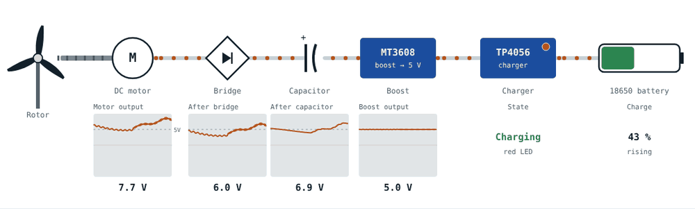
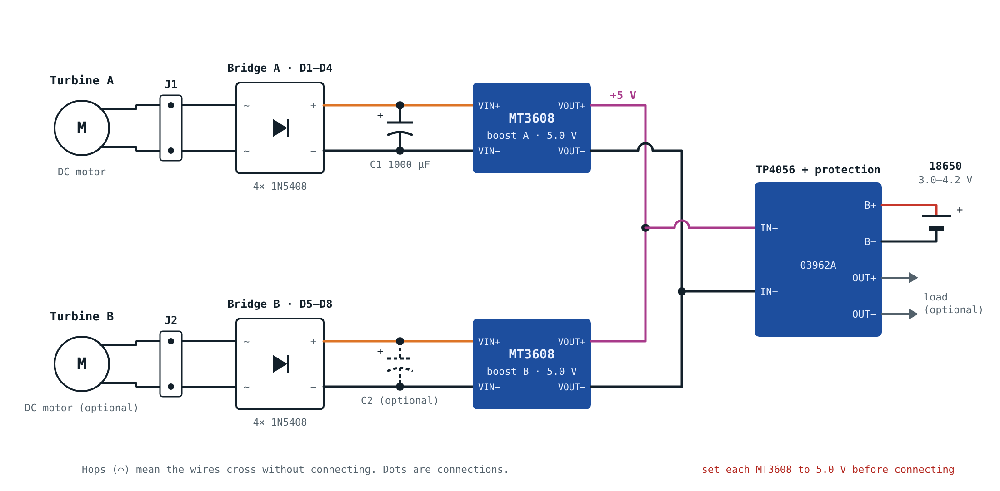
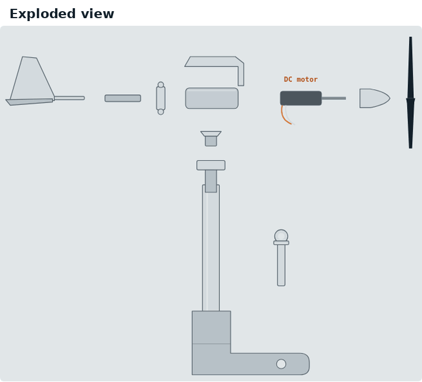

# Wind Turbine Project

A 3D-printed balcony wind turbine that charges an 18650 Li-ion battery. The blades spin a small DC motor that works as a generator; a bridge rectifier, an MT3608 boost converter and a TP4056 charger turn its output into safe charging. Everything is hand-soldered on perfboard. No custom PCB.

**Build guide:** https://AntonisPsarras.github.io/wind-turbine-project/

**Print files:** https://makerworld.com/en/models/2967248-wind-turbine-project-functional-simple-turbine



## What's in the guide

- How it works, with an interactive simulation
- Parts list
- Schematic
- Annotated photo of the original board and a layout drawing
- How to wire the bridge rectifier
- Soldering order with a check after each step
- Animated assembly of the printed parts
- Testing, troubleshooting and optional upgrades





## Repository layout

```
index.html        the website (single page, no build step)
favicon.svg       browser tab icon
images/           photos used on the page
media/            GIFs and diagrams (also used in the MakerWorld description)
.nojekyll         tells GitHub Pages to serve files as they are
```

## Safety

Lithium cells can overheat or catch fire if shorted, reversed or overcharged. Use a TP4056 board with protection (B+/B− and OUT+/OUT− pads), set each MT3608 to 5.0 V before connecting it, and keep the box dry and out of direct sun.
